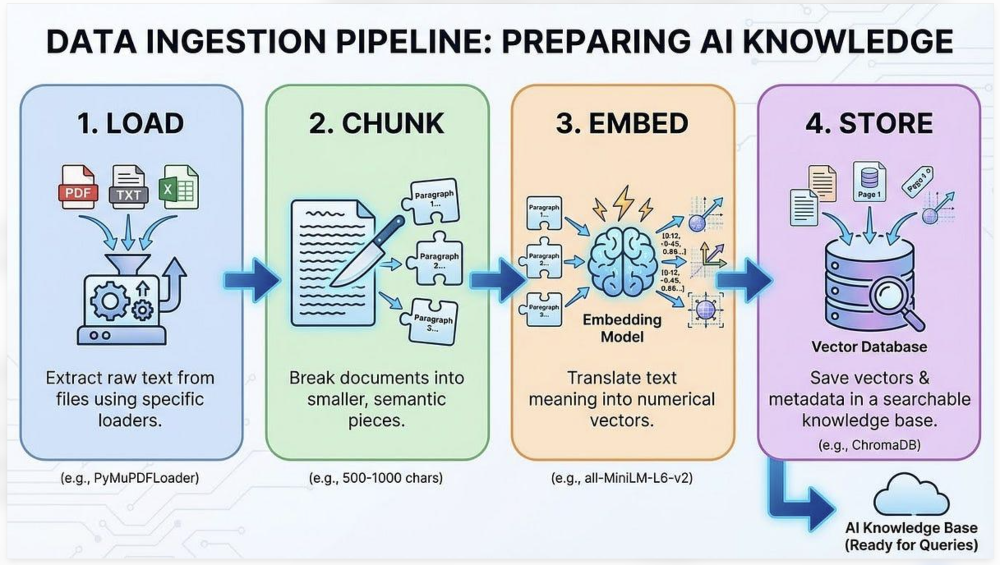

# RAG Application

A document-grounded question-answering API built with **FastAPI**, **PostgreSQL + pgvector**, and **Google Gemini**. Documents are parsed, split into chunks, embedded as vectors, and stored in PostgreSQL. When a user asks a question, the application retrieves relevant evidence and generates an answer grounded in that context.



## Features

- PDF, TXT, and DOCX parsing (OCR for scanned PDFs depends on Tesseract).
- Text chunking with overlap.
- Gemini embeddings stored in PostgreSQL using pgvector.
- Semantic retrieval with department-based filtering.
- Gemini answer generation and evidence/citation checks.
- JWT authentication and department-based authorization.
- Docker Compose deployment for local development.
- Automated tests and GitHub Actions CI.

## Architecture

```text
PDF / TXT / DOCX
       |
       v
 Text extraction / OCR
       |
       v
 Chunking with overlap
       |
       v
 Gemini embeddings
       |
       v
 PostgreSQL + pgvector
       |
Question -> question embedding -> authorized vector search
                                      |
                                      v
                              Retrieved evidence
                                      |
                                      v
                                    Gemini
                                      |
                                      v
                             Answer + sources
```

## Technology stack

- Python, FastAPI, Uvicorn
- PostgreSQL and pgvector
- Google Gemini API for embeddings and answer generation
- JWT and Argon2-compatible password hashing
- Docker, Docker Compose, pytest, GitHub Actions

## Prerequisites

- Git
- Docker Desktop with Docker Compose
- A Google Gemini API key
- Python and the dependencies in `requirements.txt` if running scripts directly on the host

## Configuration

Create `.env` based on `.env.example`. Set the values required by your current `docker-compose.yml` and application configuration, including the Gemini API key, database credentials, and JWT settings. Never commit `.env` or real secrets.

Example variable names (use the exact values and names required by your repository):

```dotenv
GEMINI_API_KEY=replace_with_your_key
DATABASE_HOST=postgres
DATABASE_PORT=5432
DATABASE_NAME=rag_db
DATABASE_USER=rag_user
DATABASE_PASSWORD=replace_with_a_password
APP_ENV=development
LOCAL_AUTH_ENABLED=true
JWT_SECRET=replace_with_a_long_random_secret
JWT_ISSUER=rag-application
JWT_AUDIENCE=rag-application
JWT_ACCESS_TOKEN_MINUTES=30
```

These are placeholders, not production-ready credentials.

## Run with Docker Compose

From the repository root:

```bash
docker compose up --build -d
docker compose ps
docker compose logs -f api
```

If the Compose port mapping uses port 8000, open:

- Swagger UI: `http://localhost:8000/docs`
- Health: `http://localhost:8000/health`
- Readiness: `http://localhost:8000/readiness`

Stop the services without deleting the database volume:

```bash
docker compose down
```

Avoid `docker compose down -v` unless you intentionally want to delete the persistent PostgreSQL volume and its data.

## Ingest a document: text → chunks → embeddings → PostgreSQL

Document ingestion is separate from the question-answering endpoint. The current API does not expose a document-upload endpoint; documents must be ingested before they can be retrieved.

### How ingestion works

1. **Parse:** extract text from a PDF, TXT, or DOCX file. Scanned PDFs may require OCR.
2. **Chunk:** split the text into smaller passages with overlap to preserve context across boundaries.
3. **Embed:** generate a vector embedding for each chunk using the configured Gemini embedding model.
4. **Save metadata:** store document ID, filename, department, status, and sharing metadata.
5. **Save vectors:** store chunk text, page/source metadata, and embeddings in PostgreSQL. The current schema uses `vector(1536)` for chunk embeddings.
6. **Retrieve:** when a user asks a question, embed the question and use pgvector similarity search to find relevant chunks, subject to the user's authorized departments.

### Example ingestion command

If `scripts/ingest_document.py` exists in your checkout, run from the repository root with the virtual environment active:

```bash
source .venv/bin/activate

python -m scripts.ingest_document \
  data/documents/hr_policy.pdf \
  --department HR \
  --status active
```

Change the file path to match your document. This example assumes the script supports these arguments; verify the current CLI with:

```bash
python -m scripts.ingest_document --help
```

If that script is not present in your checkout, add/verify it before using the command.

### Verify the database

Check document metadata:

```sql
SELECT document_id, filename, department, status, is_shared
FROM documents
ORDER BY document_id;
```

Check chunk and embedding counts:

```sql
SELECT
    document_id,
    COUNT(*) AS total_chunks,
    COUNT(embedding) AS chunks_with_embeddings
FROM chunks
GROUP BY document_id
ORDER BY document_id;
```

For a fully embedded document, `chunks_with_embeddings` should equal `total_chunks`.

### Document identity and access

The current ingestion convention derives a document ID from the filename stem; for example, `hr_policy.pdf` becomes `hr_policy`. Re-ingesting a document with the same ID may replace existing chunks, depending on the ingestion script implementation. Verify its behavior before re-ingesting important documents.

Set the correct department and sharing metadata. Shared documents may be available across authorized departments; do not mark confidential documents as shared unless intended.

## Ask a question

1. Open `http://localhost:8000/docs`.
2. Use the authentication endpoint shown in Swagger to log in and obtain an access token.
3. Use Swagger's **Authorize** control to provide the Bearer token.
4. Call `POST /api/v1/ask` with a question whose answer is present in an ingested document.

Example request body (confirm the exact schema in Swagger):

```json
{
  "question": "What does the HR policy say about ...?"
}
```

The endpoint authenticates the user and applies their authorized department permissions before retrieval. The response should include an answer and source information when available. `POST /api/v1/ask` does not upload documents.

## Authentication and authorization

- Use the login endpoint documented in `/docs` to obtain a token.
- Send the token as a Bearer token to protected endpoints.
- Permissions are resolved from trusted user information in the database.
- Retrieval is limited to the user's authorized departments, with shared-document access controlled by metadata.
- Department access must come from authenticated permissions, not a client-supplied department field.

For local-user creation, inspect the current script's usage before running it:

```bash
python -m scripts.create_local_user --help
```

## Run tests

```bash
source .venv/bin/activate
pip install -r requirements.txt
pytest
```

Review the test summary and warnings. Some tests may be intentionally deselected by project configuration.

## Continuous integration

The GitHub Actions workflow runs automated tests and builds the Docker image; the current workflow also includes a container-runtime smoke-test job. Check the repository's **Actions** tab to confirm the result for each pushed commit.

## Repository layout

```text
app/
  api/          FastAPI routes and authentication
  database/     Database schema and persistence
  embeddings/   Embedding generation
  ingestion/    Parsing and chunking
  rag/          RAG orchestration and answer generation
  retrieval/    Vector retrieval
scripts/        Database and local development scripts
tests/          Unit, integration, and RAG evaluation tests
Dockerfile
docker-compose.yml
requirements.txt
```

Exact files may evolve as the project grows.

## Security notes

- Never commit `.env`, API keys, passwords, JWT secrets, tokens, or production data.
- Use a unique, strong JWT secret for each environment.
- Restrict database access and use least-privilege credentials.
- Verify department and sharing metadata before ingesting confidential files.
- Review CI results before merging or releasing changes.

## Current limitations

- Document ingestion is separate from the question API; there is no public document-upload endpoint currently.
- Retrieval quality depends on document text quality, chunking, embedding quality, and source relevance.
- OCR quality depends on the scanned document and OCR configuration.
- Confirm example commands against the actual scripts and environment configuration in your checkout.

## License

This project is licensed under the MIT License. See the [LICENSE](LICENSE) file for details.
